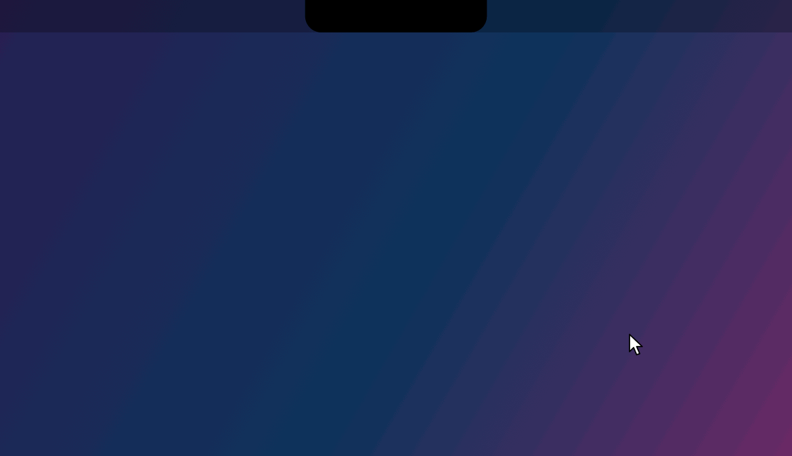

# myNotch

A small macOS app that turns the MacBook notch into a little workspace. Hover the notch and it grows into a panel with a music player, a clipboard shelf, a quick note and, optionally, your [Nova Notes](https://novanotes.lauxen.dev) pages.



## Features

**Player.** Shows what is playing and controls it: play/pause, previous, next, seek by clicking the progress bar, and like. It works with:
- the [YouTube Music desktop app](https://github.com/pear-devs/pear-desktop) with its **API Server** plugin enabled (port `26538`);
- a YouTube video playing in **Google Chrome**, used when the app is closed or paused. Turn on *View › Developer › Allow JavaScript from Apple Events* in Chrome.

**Shelf.** Everything you copy (screenshots and text) is kept in a strip of cards. Drag a card out to paste it anywhere, drag cards to reorder them, and copy text back with one click. Items marked as concealed by password managers are skipped. You choose how many items to keep and whether to keep text, images or both.

**Quick note.** A rich-text note that is always one hover away: bold, italic, underline, strikethrough, headings, lists and checkboxes you can tick. It has **voice dictation**: click the mic (or press ⇧⌘V), speak, and the text appears at the cursor. A glowing orb pulses with your voice so you know the mic is picking you up. Recognition runs on your Mac when supported, in Portuguese, English or Spanish.

**Nova Notes (optional).** Browse, search, create and edit your Nova Notes pages. Notes are stored as Markdown and shown formatted (headings, bold, links, tasks, code), with a **reading mode** where links open and tasks tick on click, and an **editing mode** where the Markdown symbols show up only on the line you are editing. Changes save automatically. Ticking tasks in a goal note updates its progress, the same way the web app does.

**Settings.** Open at login, app language (English or Portuguese), Nova Notes integration on/off, shelf size and contents, dictation microphone and language, auto-stop after silence, quick note font size, and custom shortcuts.

The panel stays open while you use a menu or popup opened from it, and while dictating, so it doesn't close under your mouse.

## Requirements

- macOS 13 or later. Made for MacBooks with a notch; on other Macs it uses a 28 pt band at the top of the built-in display.
- Swift 5.9 or later (Xcode or the Command Line Tools).

## Build and run

```bash
git clone https://github.com/itslauxen/myNotch.git
cd myNotch
./build.sh
open myNotch.app
```

`build.sh` compiles a release build and packages `myNotch.app`, signed ad hoc, so no developer account is needed. The app lives in the notch and in the menu bar; it has no Dock icon.

On first use macOS asks for:
- **Automation** of Google Chrome, to read and control YouTube;
- **Microphone** and **Speech Recognition**, for dictation.

Because the build is signed ad hoc, macOS may ask for these again after you rebuild.

## Shortcuts

| Shortcut | Action |
|---|---|
| ⌥⌘N | Show or hide the notch (works from any app) |
| ⇧⌘V | Start or stop dictation in the quick note |
| ⌘B, ⌘I, ⌘U | Bold, italic, underline |
| ⇧⌘T, ⇧⌘C, ⇧⌘L, ⇧⌘X | Heading, checkbox, list, strikethrough |

The first two can be changed in Settings.

## Nova Notes integration

The Nova tab talks to the Nova Notes [Supabase](https://supabase.com) project over its REST API, signed in with your own account, so row-level security limits it to your pages. Only a refresh token is stored (in a file readable only by you), never your password. Turn the integration off in Settings to hide the tab.

## Where data is stored

Everything stays on your Mac, in `~/Library/Application Support/myNotch`: the quick note (`notas.rtf`), the shelf items (`prints/`) and the Nova Notes session. Nothing is sent anywhere except to YouTube Music and Chrome on your Mac, and to Nova Notes when the integration is on.

## Project layout

| Path | What it is |
|---|---|
| `Sources/myNotch/MyNotchApp.swift` | App entry, menu bar item, hover tracking, global shortcut |
| `Sources/myNotch/NotchPanel.swift` | The transparent window at the top of the screen and the panel sizes |
| `Sources/myNotch/Views.swift` | Notch shape, tab bar, player and shelf |
| `Sources/myNotch/NotasView.swift` | Quick note editor, checkboxes and dictation button |
| `Sources/myNotch/NovaView.swift`, `NovaStore.swift` | Nova Notes tab and its Supabase client |
| `Sources/myNotch/AjustesView.swift`, `Configuracoes.swift` | Settings screen, stored settings and shortcuts |
| `Sources/myNotch/Ditado.swift` | Dictation (AVCaptureSession + Speech) |
| `Sources/myNotch/MusicClient.swift`, `ChromeYouTube.swift` | YouTube Music API and Chrome via Apple Events |
| `Sources/Excecoes` | Tiny Objective-C helper that catches Scripting Bridge exceptions |

The code and its comments are in Portuguese; the interface is available in English and Portuguese.
